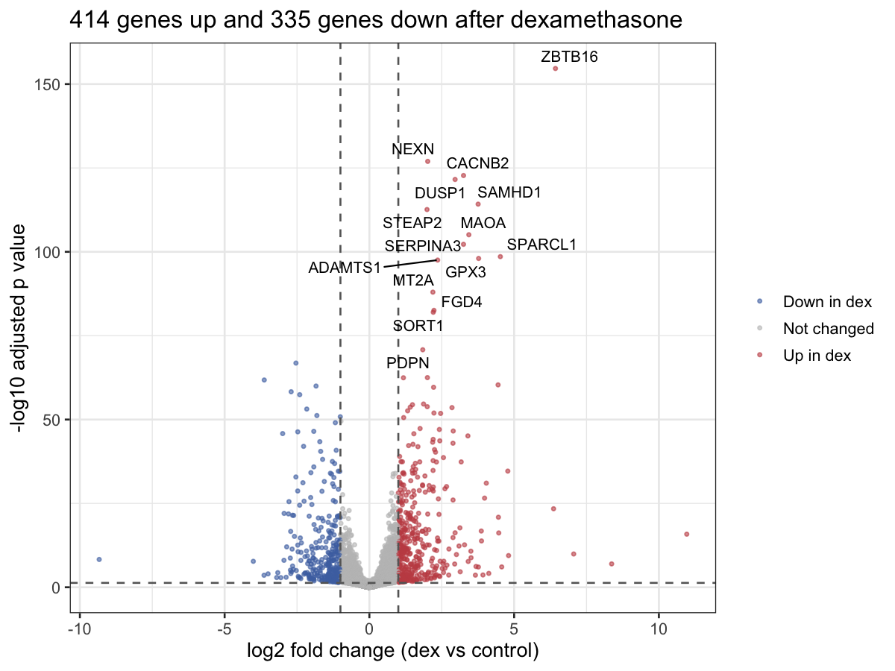
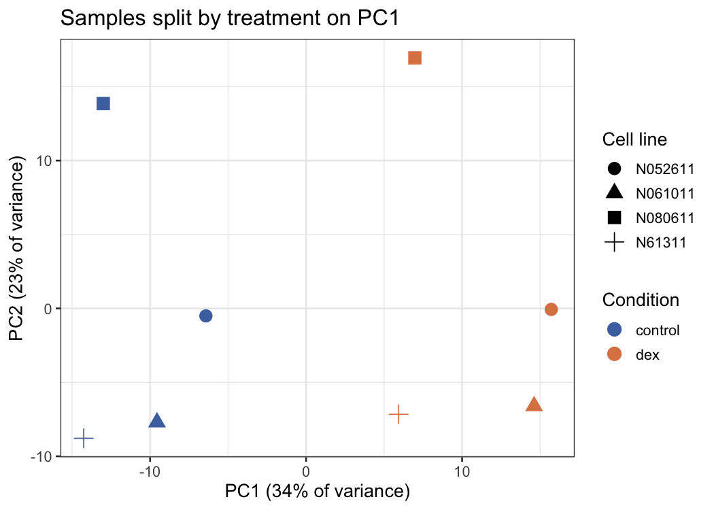
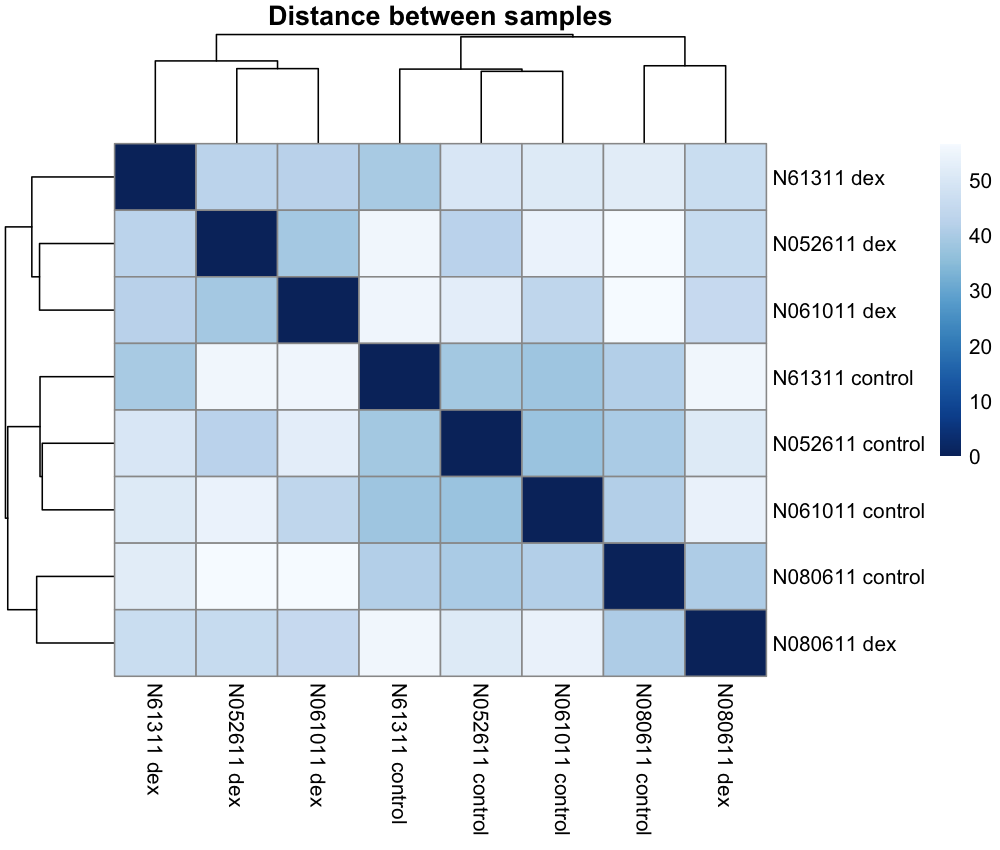
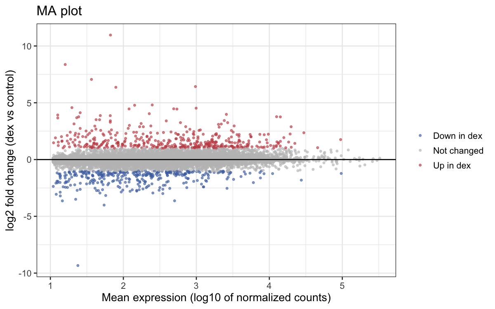
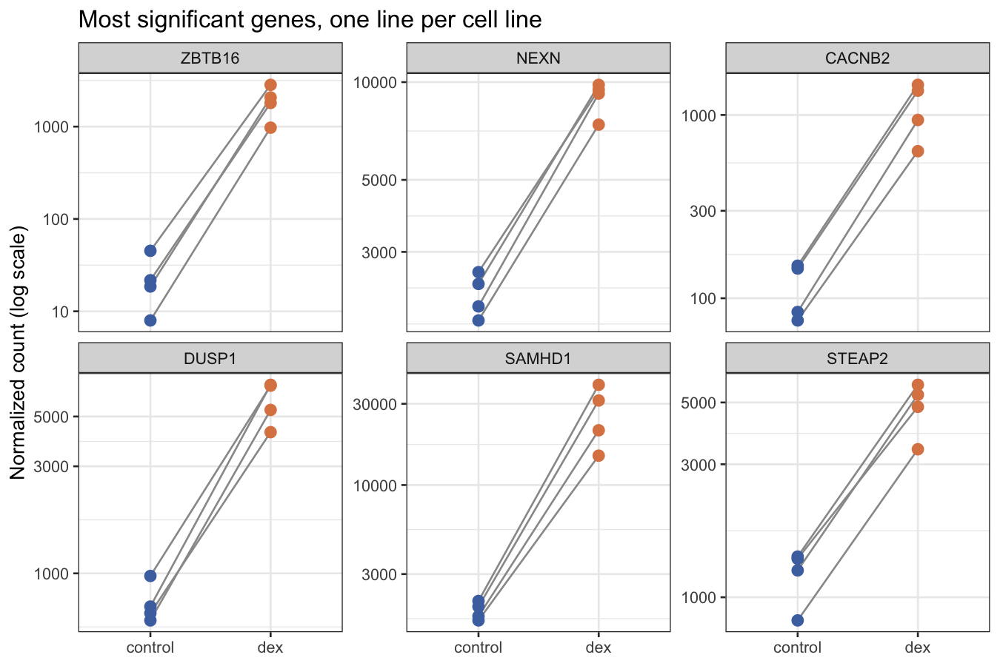
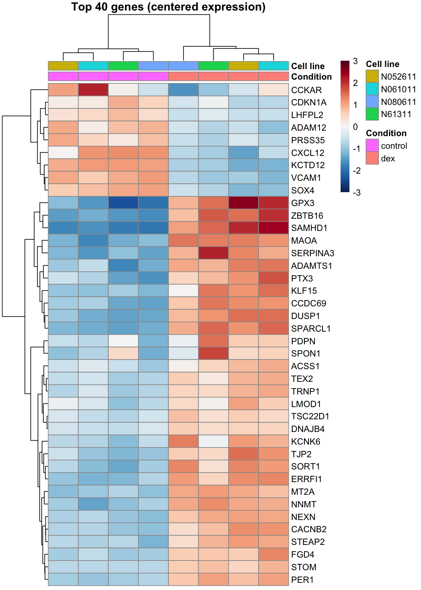
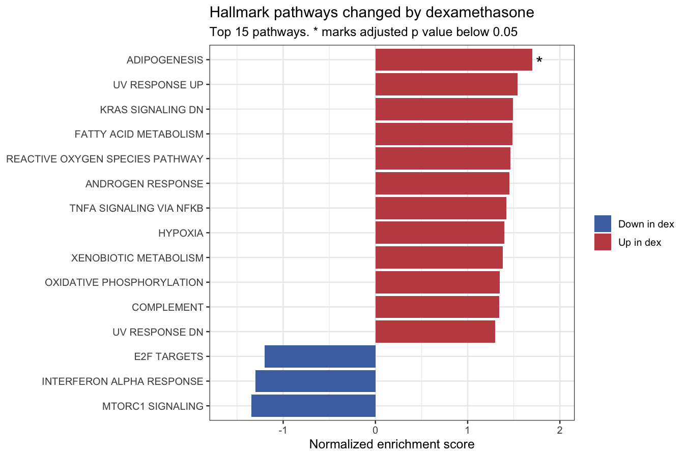

# Bulk RNA seq: how airway cells respond to a steroid

This project is a complete bulk RNA seq pipeline that goes from raw FASTQ files on a public archive all the way to differentially expressed genes, figures and pathway results. It uses public data, runs with one command, and every step is explained in plain words, so you can follow it, rerun it, or point it at your own samples.

**Question:** Which genes do human airway smooth muscle cells switch on or off when treated with dexamethasone, a steroid used to treat asthma?



## The data

Himes et al. 2014, *PLoS ONE*. GEO accession [GSE52778](https://www.ncbi.nlm.nih.gov/geo/query/acc.cgi?acc=GSE52778), SRA study SRP033351.

Airway smooth muscle cells from four people (four cell lines) were each split in two. One half was treated with 1 µM dexamethasone for 18 hours, and the other half was left untreated. That gives 8 samples in matched pairs. Libraries were sequenced on Illumina HiSeq 2000 as paired end 63 bp reads.

| Sample | Cell line | Condition |
|---|---|---|
| SRR1039508 | N61311 | control |
| SRR1039509 | N61311 | dex |
| SRR1039512 | N052611 | control |
| SRR1039513 | N052611 | dex |
| SRR1039516 | N080611 | control |
| SRR1039517 | N080611 | dex |
| SRR1039520 | N061011 | control |
| SRR1039521 | N061011 | dex |

This is the same data used in the well known Bioconductor `airway` package. Here, though, we start from the raw reads and do every step ourselves.

## What the pipeline does

```
FASTQ from ENA ──> fastp ──> Salmon ──> tximport ──> DESeq2 ──> plots
                     │          │                       │
                     └── MultiQC report ──┘              └──> fgsea (hallmark pathways)
```

| Step | Tool | What happens |
|---|---|---|
| 1 | curl | Download the reads straight from the European Nucleotide Archive |
| 2 | fastp | Trim adapters and low quality bases, and write a QC report per sample |
| 3 | Salmon | Build an index of all human transcripts (GENCODE 48) and count reads per transcript |
| 4 | MultiQC | Gather all fastp and Salmon reports into one page |
| 5 | tximport | Add transcript counts up into gene counts |
| 6 | DESeq2 | Test every gene for a change between dex and control, within each cell line |
| 7 | ggplot2, pheatmap | PCA, sample distances, MA plot, volcano plot, heatmap and gene plots |
| 8 | fgsea, msigdbr | Gene set enrichment with the 50 MSigDB hallmark pathways |

Everything is joined together with Snakemake, so it knows which steps to rerun when something changes.

## Two ways to run it

**Test mode (the default).** The pipeline streams only the first 2 million read pairs of each sample. This needs about 2 GB of downloads and finishes in around 20 to 30 minutes on a laptop. It is enough to find the main dexamethasone genes, and it is the best way to check that everything works.

**Full mode.** Every read is used, which means about 25 GB of downloads. The results and figures in this README come from full mode. On a home connection the whole run took several hours, and most of that time was spent downloading. If the connection drops, the download step picks up where it stopped. Turn it on by setting `test_mode: false` in `config/config.yaml`, or from the command line:

```bash
snakemake --cores 8 --config test_mode=False
```

## Results

Results below are from full mode, with every read (16 to 33 million read pairs per sample).

### 1. Read quality and mapping

fastp found good quality reads with very little adapter in them. Salmon mapped 95 to 96% of fragments in every sample, which is very high and shows the libraries are clean. All of these numbers are collected in `results/multiqc/multiqc_report.html`.

### 2. Sample level checks

Before looking at single genes, it is worth checking that samples group the way we expect. On the PCA, the first component (34% of the variance) splits every treated sample from every control. The second component mostly separates the cell lines, especially N080611. This tells us two things. The treatment has a big, clear effect, and the cell lines differ from each other too. That is why the model includes cell line.





### 3. Differential expression

DESeq2 was run with the design `~ cell_line + condition`. This compares treated and control cells within the same person, which removes the differences between people from the test. Fold changes were shrunk with apeglm, so genes with few reads do not get huge, noisy fold changes.

Out of 17,949 genes that passed the expression filter, **749 genes** changed by more than 2 fold with an adjusted p value below 0.05. Of these, **414 went up** and **335 went down**. If we drop the fold change cutoff, 3,659 genes change by some amount. Steroids touch a large part of the genome, but most of those changes are small.



The top genes are well known targets of the glucocorticoid receptor, the protein that steroids like dexamethasone act through. They are also the genes the original paper reported.

| Gene | log2 fold change | What it is |
|---|---|---|
| FKBP5 | +4.0 | Classic steroid response gene. Often used as a marker that a steroid is working |
| TSC22D3 (GILZ) | +3.1 | Switches off inflammation, a key part of how steroids calm the airway |
| DUSP1 | +3.0 | Turns off inflammatory signalling inside the cell |
| KLF15 | +4.4 | Known steroid target in airway smooth muscle |
| ZBTB16 | +6.4 | One of the most strongly induced steroid genes in many tissues |
| CRISPLD2 | +2.6 | Highlighted by Himes et al. as a new asthma related steroid target |
| PER1 | +2.9 | Body clock gene that responds directly to steroids |
| CXCL12 | −1.8 | A chemokine that draws in immune cells. Pushed down by the steroid |

ZBTB16 is the most significant gene of all. Other genes near the top of the list include SAMHD1, MAOA, SERPINA3, GPX3, SPARCL1 and MT2A. All of them are known to go up with steroids.



Each line in the plot above joins the control and treated sample from one cell line. The change goes the same way in all four people, even though their starting levels differ.



### 4. Pathways

For gene set enrichment, every tested gene is ranked by how strongly and in which direction it changed. fgsea then checks whether the genes in each hallmark pathway sit near the top or the bottom of that list. Adipogenesis comes out on top and is the only pathway with an adjusted p value below 0.05. This makes sense, since steroids are known to push cells toward fat related programs. Fatty acid metabolism, androgen response and TNF alpha signalling come next, but they do not pass the cutoff. The androgen and glucocorticoid receptors share many target genes, so the androgen result fits too.

The pathway signal is modest. That is not a surprise. Only four pairs of samples were used, and the hallmark sets are broad. Many of the strongest steroid genes, such as ZBTB16 and FKBP5, are not in any single hallmark set. The gene level results above are the main story of this data.



## How to run it

You need [conda](https://docs.conda.io) or [mamba](https://mamba.readthedocs.io), an internet connection and about 10 GB of free disk space for test mode (most of it is the Salmon index). Full mode needs about 60 GB.

```bash
git clone https://github.com/hafizmtalha/bulk-rnaseq-airway.git
cd bulk-rnaseq-airway

# Create the software environment (one time only)
mamba env create -f environment.yml
conda activate bulk-rnaseq-airway

# See what will run
snakemake --cores 8 --dry-run

# Run everything
snakemake --cores 8
```

## Main outputs

| File | What is in it |
|---|---|
| `results/multiqc/multiqc_report.html` | Read quality and mapping rates for all samples |
| `results/salmon/<sample>/quant.sf` | Transcript level counts for each sample |
| `results/deseq2/deseq2_results.tsv` | Every tested gene with fold change, p value and adjusted p value |
| `results/deseq2/significant_genes.tsv` | Only the genes that passed the cutoffs |
| `results/deseq2/normalized_counts.tsv` | Counts corrected for sequencing depth, handy for plotting |
| `results/deseq2/dds.rds` | The DESeq2 object, so you can load it in R and keep exploring |
| `results/gsea/hallmark_gsea.tsv` | Enrichment results for all 50 hallmark pathways |
| `results/plots/` | All figures |

## Folder layout

```
bulk-rnaseq-airway/
├── config/
│   ├── config.yaml           settings: test mode, cutoffs, threads, reference link
│   └── samples.tsv           sample sheet with links to the raw reads
├── environment.yml           all software with versions
├── workflow/
│   ├── Snakefile             main file that ties the rules together
│   ├── rules/                download, QC, quantification and analysis rules
│   └── scripts/              R and Python scripts used by the rules
├── docs/figures/             figures shown in this README
├── data/                     downloaded reads and reference (made by the pipeline)
├── results/
└── logs/
```

## Changing the settings

Everything you might want to change is in `config/config.yaml`.

| Setting | Default | What it does |
|---|---|---|
| `test_mode` | true | Use only the start of each FASTQ file |
| `test_read_pairs` | 2000000 | How many read pairs to keep in test mode |
| `transcriptome_url` | GENCODE 48 | Which human transcript set to build the index from |
| `threads` | 4 | CPU cores used by fastp, Salmon and the index |
| `padj_cutoff` | 0.05 | Highest adjusted p value to call a gene changed |
| `log2fc_cutoff` | 1 | Smallest log2 fold change to call a gene changed (1 means 2 fold) |

## Using it with your own data

1. Edit `config/samples.tsv`. Put one row per sample with a sample name, a grouping column and links to read 1 and read 2. Local file paths work too if you change the download rule to a simple copy.
2. If your groups have different names, change the column names and factor levels at the top of `workflow/scripts/run_deseq2.R`, and update the coefficient name in `lfcShrink`.
3. If your samples are not paired, change the design to `~ condition`.
4. For mouse data, swap the GENCODE link for the mouse transcript file and change `species` in `run_gsea.R` to `"Mus musculus"`.

## A few notes on the choices made

* **Why Salmon and not a genome aligner like STAR?** For gene level counting, Salmon is much faster, needs far less memory and gives results that are as good or better. It also corrects for GC and sequence bias, which we switch on here.
* **Why put cell line in the model?** The four cell lines come from four different people, who differ from each other a lot (PC2 on the PCA). Comparing each treated sample with its own control removes that noise and gives much more power.
* **Why shrink fold changes?** A gene with 3 reads in control and 30 in treated has a 10 fold change, but we cannot trust it. apeglm pulls such noisy estimates toward zero, so the ranking and the plots focus on changes we can trust.
* **Why rank all genes for GSEA?** Using only genes past a cutoff throws away information. GSEA uses every tested gene, so it can pick up pathways where many genes move a little.

## Software

Snakemake, fastp, Salmon, MultiQC, R, tximport, DESeq2, apeglm, fgsea, msigdbr, ggplot2, pheatmap. Exact versions are pinned in `environment.yml`.

## References

* Himes BE et al. RNA seq transcriptome profiling identifies CRISPLD2 as a glucocorticoid responsive gene that modulates cytokine function in airway smooth muscle cells. *PLoS ONE* 9, e99625 (2014).
* Patro R et al. Salmon provides fast and bias aware quantification of transcript expression. *Nature Methods* 14, 417 to 419 (2017).
* Love MI, Huber W, Anders S. Moderated estimation of fold change and dispersion for RNA seq data with DESeq2. *Genome Biology* 15, 550 (2014).
* Soneson C, Love MI, Robinson MD. Differential analyses for RNA seq: transcript level estimates improve gene level inferences. *F1000Research* 4, 1521 (2015).
* Zhu A, Ibrahim JG, Love MI. Heavy tailed prior distributions for sequence count data. *Bioinformatics* 35, 2084 to 2092 (2019).
* Korotkevich G et al. Fast gene set enrichment analysis. *bioRxiv* 060012 (2021).
* Chen S et al. fastp: an ultra fast all in one FASTQ preprocessor. *Bioinformatics* 34, i884 to i890 (2018).
* Ewels P et al. MultiQC: summarize analysis results for multiple tools and samples in a single report. *Bioinformatics* 32, 3047 to 3048 (2016).

## License

MIT. See [LICENSE](LICENSE).
